

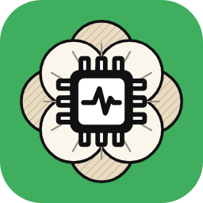

# HealthBloom

**Clean, tune and check your Windows PC — in one tap.**

A fast, good-looking PC care app for Windows 10 and 11, with a calm dark glass interface,
a one-button **Simple** mode and a full **Expert** mode for people who want to see everything.

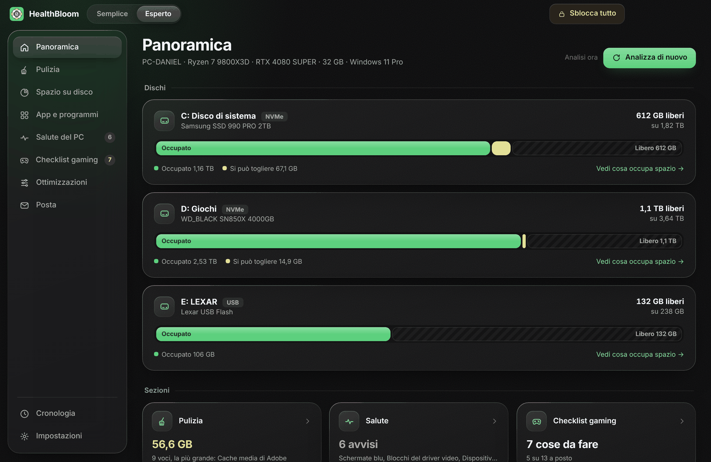

---

## ✨ Highlights

| | |
|---|---|
| 🧹 **One-tap optimize** | Clears caches, temp files and leftovers, applies safe settings and removes Windows bloat in a single click. |
| 💽 **Disk explorer** | See what fills each drive like in File Explorer, folder by folder, with a treemap. System folders are locked so you can't break Windows. |
| 📦 **Apps & startup** | All installed programs with icons, size and *last used* date. Turn off startup apps, uninstall what you never use. |
| 🩺 **PC health** | Reads the Windows Event Viewer and explains blue screens, GPU driver crashes and broken devices in plain words. Export a report ready to paste into an AI. |
| 🎮 **Gaming checklist** | Sleep and power plan, XMP/EXPO, dual channel, drivers, Game Mode, refresh rate, VBS… sorted by importance, with one-click fixes. Installs driver updates from inside the app. |
| ⚙️ **Tweaks** | 30+ privacy, interface and performance switches, every change verified after it's applied. Restore point in one click. |
| ✉️ **Mail cleanup** | Connect Gmail, iCloud, Yahoo or Libero and unsubscribe from newsletters automatically — receipts, codes, payments and account mail are always protected. |
| 🛡️ **Safe by design** | Every destructive action asks first and is logged in History. Runs as administrator, stays light, never lags. |

## 📸 Screenshots

<table>
  <tr>
    <td width="34%">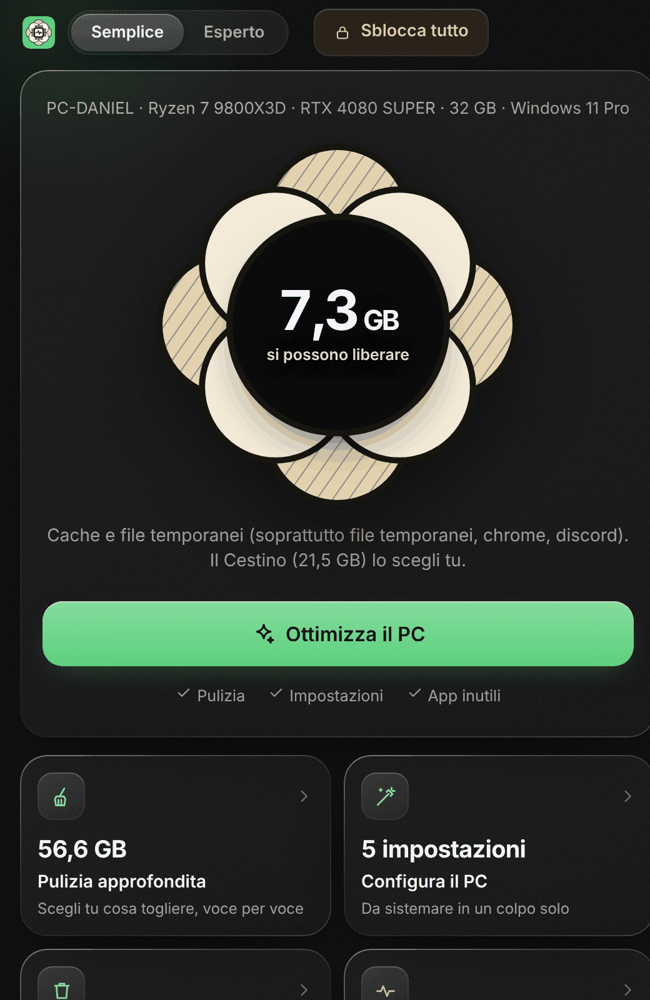
<b>Simple mode</b>
</td>
    <td>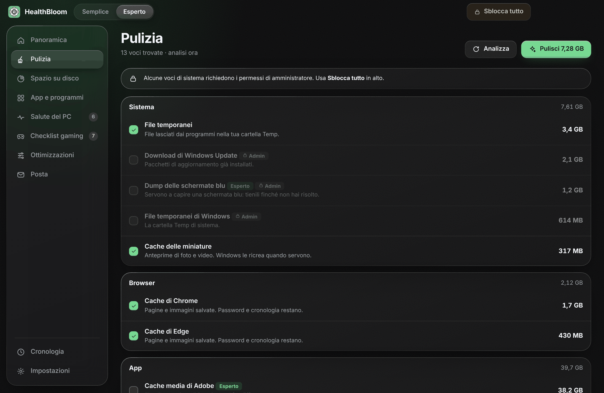
<b>Cleanup</b>
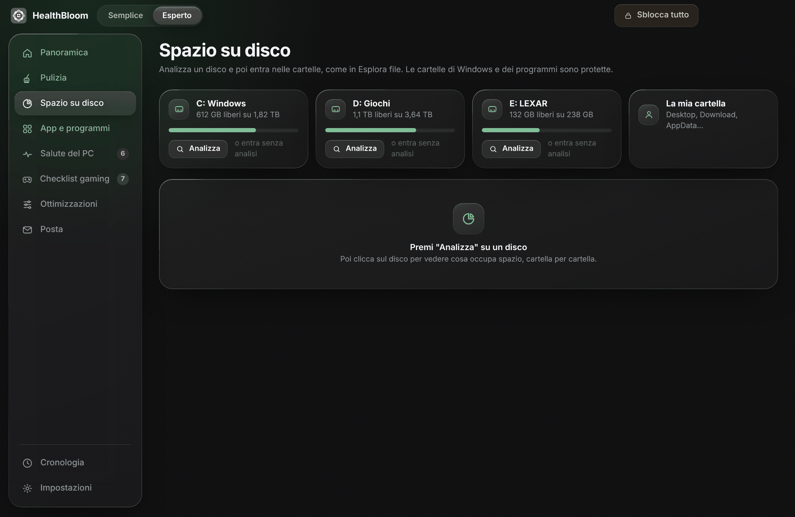
<b>Disk space</b>
</td>
  </tr>
</table>

<table>
  <tr>
    <td>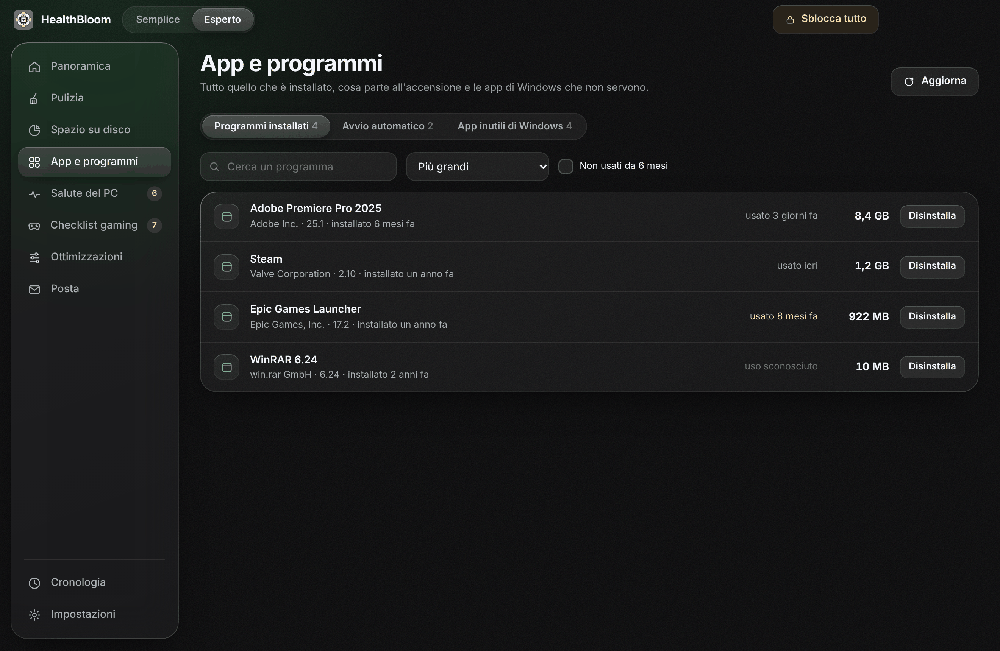
<b>Apps & programs</b>
</td>
    <td>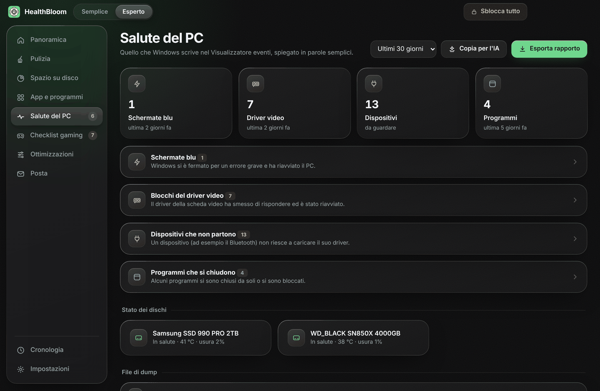
<b>PC health</b>
</td>
  </tr>
  <tr>
    <td>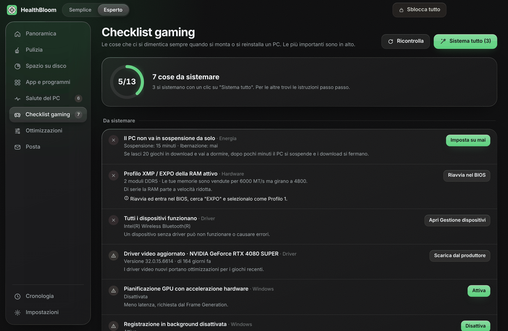
<b>Gaming checklist</b>
</td>
    <td>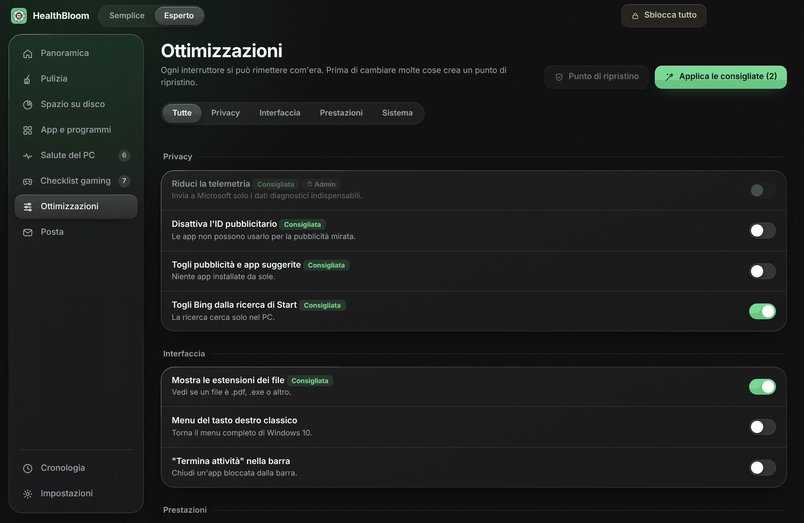
<b>Tweaks</b>
</td>
  </tr>
  <tr>
    <td>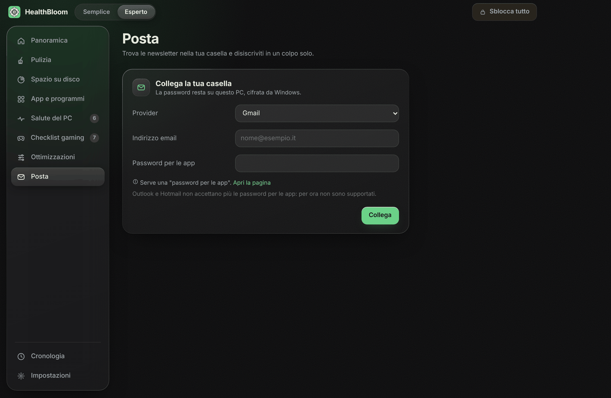
<b>Mail cleanup</b>
</td>
    <td>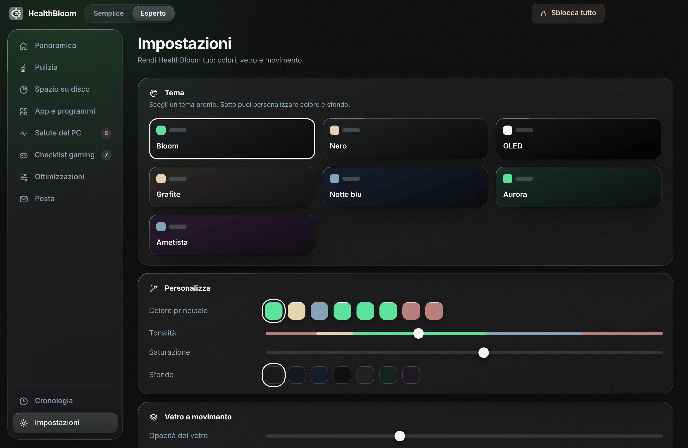
<b>Themes & settings</b>
</td>
  </tr>
</table>

## ⬇️ Install

1. Go to **[Releases](https://github.com/danielgrossi007-cpu/HealthBloom/releases/latest)** and download **`HealthBloom-Setup-x.y.z.exe`**.
2. Run it and follow the installer (you can pick the install folder).
3. Open **HealthBloom** from the Desktop or the Start menu.

> Windows SmartScreen may warn you because the app isn't code-signed yet: click **More info → Run anyway**.

**Requirements:** Windows 10 or 11 (64-bit). Administrator rights are requested at launch so cleanup and settings can work fully.

## 🌸 Part of the Bloom Suite

HealthBloom is the first app of the **Bloom Suite** — a family of Windows apps that share one look:
a white glyph with a bold black outline at the heart of an engraved flower, on a solid colour tile.

## 🔒 Privacy

Everything runs locally on your PC. No accounts, no telemetry. Mail passwords are encrypted with Windows' own protection and never leave your computer.

---

© 2026 Daniel · HealthBloom · All rights reserved. The source code is not public.

